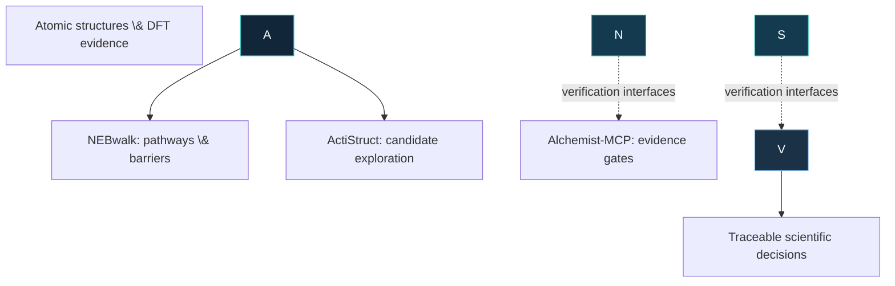

<!-- GitHub profile README | Single-file design: no local image assets required. -->

<div align="center">


### First-principles simulation × Scientific machine learning × Reproducible software

*Turning atomic-scale questions into testable, traceable computational evidence.*

[!\[GitHub](https://img.shields.io/badge/GitHub-Rifat19R-111827?style=for-the-badge\&logo=github\&logoColor=white)](https://github.com/Rifat19R)
[!\[NEBwalk](https://img.shields.io/pypi/v/NEBwalk?style=for-the-badge\&label=NEBwalk\&color=00A6A6)](https://pypi.org/project/NEBwalk/)
[!\[Documentation](https://img.shields.io/badge/NEBwalk-Documentation-153B5D?style=for-the-badge\&logo=readthedocs\&logoColor=white)](https://rifat19r.github.io/NEBwalk/)
[!\[Email](https://img.shields.io/badge/Research-Collaboration-087E8B?style=for-the-badge\&logo=gmail\&logoColor=white)](mailto:rifatkh.duet@gmail.com)

</div>

\---

## 01 · Research identity

I am a **computational materials researcher and chemical engineer** developing open-source tools for atomistic simulation, reliable DFT workflows, and AI-assisted materials discovery. My work connects **quantum-mechanical calculations** with **machine-learned interatomic potentials (MLIPs)**, **active learning**, and **scientific verification**.

My interests span **surface chemistry and catalysis**, **atomic migration and transition states**, **energy-storage materials**, **MXenes and other 2D systems**, and **porous materials**. I also work across computational research and experimental materials R\&D.

> \*\*Research principle:\*\* A converged calculation, a passing software test, and a scientifically validated prediction are three different things. I build workflows that keep those distinctions explicit.

## 02 · Open-source research software

### ⚛️ [NEBwalk](https://github.com/Rifat19R/NEBwalk) — Atomic migration \& transition pathways

[!\[PyPI](https://img.shields.io/pypi/v/NEBwalk?label=PyPI\&color=00A6A6)](https://pypi.org/project/NEBwalk/)
[!\[CI](https://github.com/Rifat19R/NEBwalk/actions/workflows/ci.yml/badge.svg)](https://github.com/Rifat19R/NEBwalk/actions/workflows/ci.yml)
[!\[License](https://img.shields.io/badge/license-MIT-173B52)](https://github.com/Rifat19R/NEBwalk/blob/main/LICENSE)

An ASE-compatible **NEB/CI-NEB** framework for minimum-energy paths and activation barriers, with calculator-independent workflows and targeted **MLIP → DFT** validation. Includes IDPP/geodesic-style interpolation, FIRE optimization, periodic image handling, Quantum ESPRESSO recovery, committee disagreement diagnostics, and resumable MACE–QE active-learning campaigns.

**Application:** vacancy diffusion · surface hopping · reaction pathways · ionic migration  
**Evidence:** v0.11.0; **13 retained, artifact-audited benchmark cases** and independent ASE implementation-consistency comparisons. Uncertainty proxies are **not calibrated uncertainty**; sparse DFT single points are **not equivalent to a full DFT NEB**.

[**Source code**](https://github.com/Rifat19R/NEBwalk) · [**Documentation**](https://rifat19r.github.io/NEBwalk/) · [**PyPI**](https://pypi.org/project/NEBwalk/)

### 🧪 [ActiStruct](https://github.com/Rifat19R/ActiStruct) — Reliability-aware DFT active learning

[!\[CI](https://github.com/Rifat19R/ActiStruct/actions/workflows/ci.yml/badge.svg)](https://github.com/Rifat19R/ActiStruct/actions/workflows/ci.yml)
[!\[License](https://img.shields.io/badge/license-MIT-173B52)](https://github.com/Rifat19R/ActiStruct/blob/main/LICENSE)

A framework for **DFT-guided exploration of known structure/design variables** using Gaussian-process and GNN-embedding surrogates, uncertainty-aware acquisition, failure-risk penalties, Quantum ESPRESSO parsing, recovery, caching, and provenance ledgers.

**Application:** materials candidate selection · adsorption-site exploration · reliability-aware QE campaigns  
**Evidence:** v2.0.0; real QE records, a Ti₃C₂-O low-fidelity H-adsorption campaign, and documented offline regression testing. **High-fidelity ranking validation remains incomplete**; results do not establish generalized DFT-cost savings.

[**Source code and benchmark limitations**](https://github.com/Rifat19R/ActiStruct)

### 🛡️ [Alchemist-MCP](https://github.com/Rifat19R/Alchemist_MCP) — Scientific verification layer

A fail-closed **MCP-based verification toolkit** for DFT-to-MLIP evidence: Quantum ESPRESSO input/output inspection, unit/provenance checks, group-aware data freezing, dry-run training plans, energy/force/barrier comparison, and reference-validation gates.

**Application:** scientific data integrity · MLIP governance · auditable computational workflows  
**Evidence:** automated software checks and an engineering demonstration; **production scientific validation of migration barriers remains pending**. Training adapters do **not** claim to execute validated production training runs.

[**Source code and verification gates**](https://github.com/Rifat19R/Alchemist_MCP)

<details>
<summary><b>How the three research tools fit together</b></summary>



*Conceptual interoperability architecture; these repositories are currently separate projects, not a fully integrated platform.*

</details>

## 03 · Applied research \& reproducible datasets

|Research project|Scientific application|Public evidence|
|-|-|-|
|[**MOF CO₂/H₂ Screening**](https://github.com/Rifat19R/mof-co2-h2-screening)|ML screening of **278,778 ARC-MOF structures** for pre-combustion CO₂/H₂ separation; conformal uncertainty, SHAP, Pareto screening, and topology-level interpretation.|[**Code**](https://github.com/Rifat19R/mof-co2-h2-screening) · [**Zenodo archive**](https://doi.org/10.5281/zenodo.20305724). Database/GCMC-benchmarked, **not experimentally validated** candidate performance.|
|[**Solid-Electrolyte Validation \& Deployment**](https://github.com/Rifat19R/solid-electrolyte-validation-deployment)|Chemistry-aware validation and external generalization of **Li solid-electrolyte conductivity** models using OBELiX and an independent cohort.|[**Reproducibility package**](https://github.com/Rifat19R/solid-electrolyte-validation-deployment). Prespecified hypotheses favoring family-aware validation were **not supported**; restricted data are not redistributed.|

## 04 · Research workflow

```text
Scientific question
      ↓
Physical model + convergence requirements
      ↓
DFT / atomistic simulation / curated reference data
      ↓
Surrogate modelling • MLIPs • active learning
      ↓
Independent validation • uncertainty • failure analysis
      ↓
Reproducible evidence + physically defensible conclusions
```

## 05 · Technical toolkit

|Domain|Tools and methods|
|-|-|
|**First principles \& atomistics**|Quantum ESPRESSO · VASP · ASE · DFT workflows · NEB/CI-NEB · surface adsorption · atomic migration|
|**Scientific ML**|Python · PyTorch · MACE · Gaussian processes · GNNs · scikit-learn · XGBoost · LightGBM · SHAP|
|**Trustworthy evaluation**|Active learning · uncertainty quantification · group/OOD splits · reproducibility manifests · scientific test gates|
|**Engineering infrastructure**|Linux/WSL · Git/GitHub · CI/CD · automated testing · CLI/API development · structured data pipelines|

## 06 · Research experience \& direction

* **Co-Principal Investigator** in two World Bank/EDGE-supported energy-storage R\&D projects, bridging computational work and experimental materials research.
* Experience working with synthesis/characterization and electrochemical measurements, including **XRD, SEM/EDS, Raman, FTIR, BET, CV, EIS, and coin-cell prototyping**.
* Current priorities: **MLIP-assisted catalytic reaction pathways**, robust atomistic simulations, **sodium-ion energy materials**, and **reliable AI for scientific discovery**.
* Interested in collaborations in **computational catalysis, solid-state ion transport, 2D materials, MOFs, and reproducible scientific software**.

\---

<div align="center">

### Let's build computational science that can be independently verified.

[!\[Email](https://img.shields.io/badge/Email-Research%20collaboration-087E8B?style=flat-square\&logo=gmail\&logoColor=white)](mailto:rifatkh.duet@gmail.com)
[!\[GitHub](https://img.shields.io/badge/GitHub-Rifat19R-111827?style=flat-square\&logo=github\&logoColor=white)](https://github.com/Rifat19R)

<sub>Bangladesh · Open-source scientific software · Computational materials research</sub>


</div>

